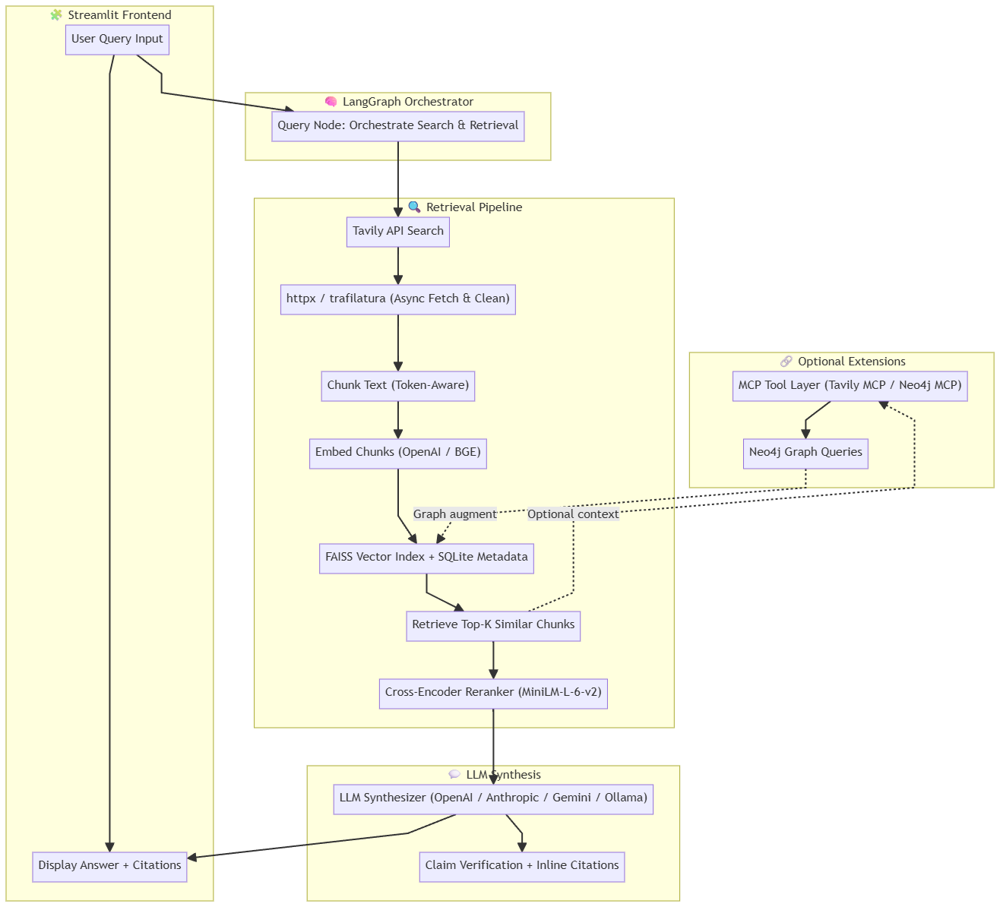
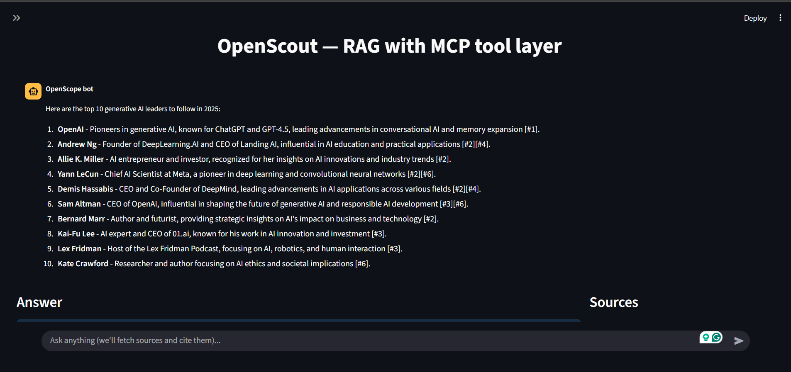
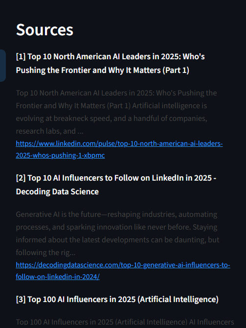
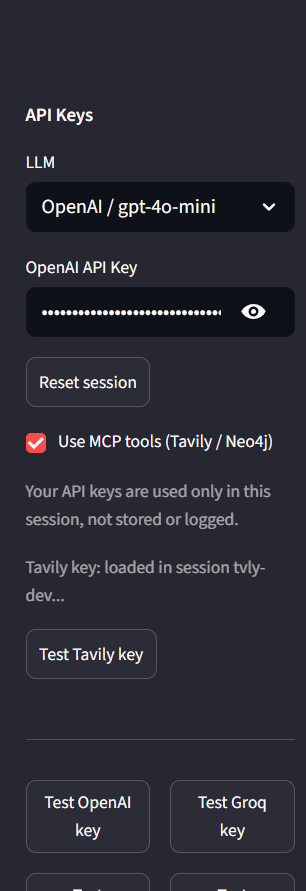

# OpenScout

OpenScout is a developer focused Retrieval Augmented Generation (RAG) search engine with multi source web retrieval, cross-encoder reranking, and citation synthesis.

It answers natural language questions by searching the web, fetching and extracting page content, chunking and embedding passages, storing vectors in FAISS, retrieving the most relevant passages, reranking them, and synthesizing a concise, cited answer using a pluggable LLM adapter.

---

## Architecture

High-level components and runtime flow:

- UI (Streamlit) — accepts user queries, handles API keys (BYOK) in the sidebar, displays chat-style answers, and renders verified citations.
- MCP layer (`core/mcp`) — optional: central tool coordination for search/extract/cypher.
- Graph pipeline (`core/graph.py`) — orchestrates nodes: search → fetch → index → retrieve.
- Fetcher (`core/fetch.py`) — downloads pages and extracts clean text (httpx + trafilatura), with fallback to search snippets.
- Chunking + Embeddings (`core/chunk.py`, `core/embed.py`) — split text into passages and compute embeddings (OpenAI or local Sentence-Transformers).
- Vector store (`core/faiss_store.py`) — FAISS index (IndexIDMap + IndexFlatIP) + SQLite metadata for passages.
- Reranker (`core/rerank.py`) — cross-encoder for higher precision.
- Synthesizer (`core/synthesize.py`) — builds the prompt from top passages with conversation history and calls the selected LLM adapter.

Runtime flow: user query → search (Tavily / MCP) → fetch pages → chunk & embed → index/store → retrieve top passages → (rerank) → LLM synthesize → UI.



---

## Files

Key files and their purposes:

- `app.py` — Streamlit entrypoint; UI, BYOK handling, per-provider key tests, chat history, and orchestration.
- `core/graph.py` — LangGraph state graph wiring pipeline nodes (search, fetch, index, retrieve).
- `core/mcp/adapters.py` — MCPTools adapter.
- `core/search.py` — Tavily search wrapper.
- `core/fetch.py` — Async fetcher using httpx and content extraction via trafilatura.
- `core/chunk.py` — Text chunking logic for splitting pages into passage-sized chunks.
- `core/embed.py` — Embedding wrapper supporting OpenAI and local Sentence-Transformers.
- `core/faiss_store.py` — FAISS index management and SQLite metadata storage.
- `core/rerank.py` — Cross-encoder-based reranker.
- `core/llm/` — LLM adapters and registry (`openai_llm.py`, `anthropic_llm.py`, `gemini_llm.py`, `groq_llm.py`, `registry.py`).
- `core/synthesize.py` — Builds the prompt and synthesizes cited answers via the LLM adapter.

---

## Screenshots

- Main chat + answer view

	

- Sources Panel

	

- Side Panel

    

---

## How to use this

Quick steps to run OpenScout locally (PowerShell commands). These instructions assume you have Python 3.10+ installed.

1. Clone or download the repository:

```powershell
git clone https://github.com/Ujjwal-Bajpayee/OpenScout.git
cd OpenScout
```

2. Create and activate a virtual environment, then install dependencies:

```powershell
python -m venv .venv
.\.venv\Scripts\Activate.ps1
pip install -r requirements.txt
```

3. Obtain credentials:
- Tavily: `TAVILY_API_KEY` for web search.
- LLM provider key: one of `OPENAI_API_KEY`, `GROQ_API_KEY`, `ANTHROPIC_API_KEY`, or `GOOGLE_API_KEY`.
- (Optional) Neo4j: URI, username, and password.

4. Create a `.env` file in the project root with the credentials (optional — keys can also be pasted in the UI):

```text
TAVILY_API_KEY=tvly...
OPENAI_API_KEY=sk-...
GROQ_API_KEY=gsk_...
ANTHROPIC_API_KEY=sk-ant-...
GOOGLE_API_KEY=AIza...
```

5. Start the Streamlit app:

```powershell
streamlit run .\app.py
```

6. In the app sidebar:
- Enter your API keys.
- Choose your LLM provider and model.
- Configure answer mode and number of sources.
